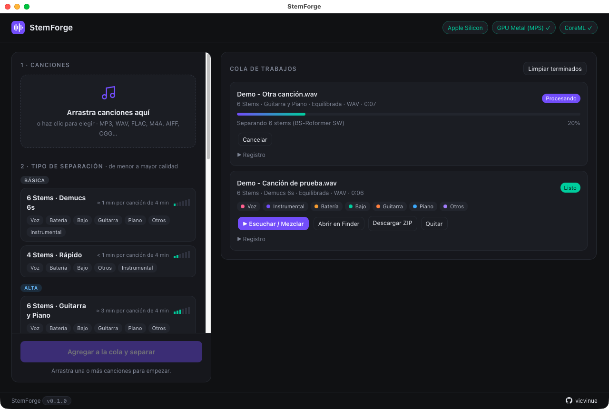
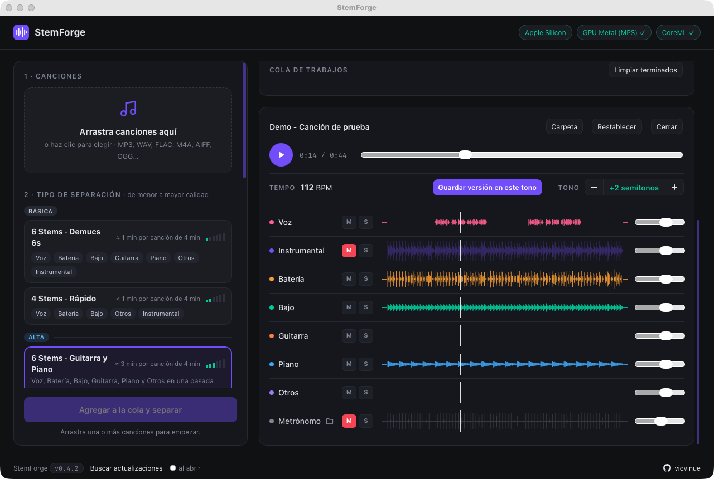

# StemForge

**Separa cualquier canción en sus pistas —voz, batería, bajo, guitarra, piano…— y practica con ellas.**
Incluye un mezclador con BPM, metrónomo y cambio de tono. Gratis y de código abierto, para
**Mac con Apple Silicon** y **Windows 10/11**. Todo se procesa en tu computador: tus canciones no se suben a
ningún sitio.

**[⬇ Descargar la última versión](https://github.com/vicvinue/stemforge/releases/latest)** · versión 0.4.2



<p align="center"><em>Elige el tipo de separación a la izquierda y sigue el progreso de cada canción a la derecha.</em></p>



<p align="center"><em>El mezclador: escucha cada pista por separado, con BPM, metrónomo y cambio de tono.</em></p>

<sub>Capturas hechas con una canción de demostración sintética.</sub>

## Descargar e instalar

En la [página de descargas](https://github.com/vicvinue/stemforge/releases/latest) elige el archivo según tu equipo:

| Tu equipo | Archivo |
|---|---|
| Mac con Apple Silicon (M1, M2, M3, M4…) | `StemForge-<versión>.dmg` |
| Windows con tarjeta gráfica NVIDIA compatible ([¿cuáles?](#gpu-nvidia-compatibles-windows)) | `StemForge-<versión>-CUDA-Setup.exe` **y** `StemForge-<versión>-CUDA-Setup-1.bin` |
| Cualquier otro Windows | `StemForge-<versión>-Setup.exe` |

Cada versión también se puede bajar por **torrent**: los enlaces están en las notas de la versión.

### Mac

1. Abre el `.dmg` y arrastra **StemForge** a la carpeta **Aplicaciones**.
2. La primera vez, macOS dirá que no puede comprobar el desarrollador (la app no está notarizada por Apple).
   Ve a **Ajustes del Sistema → Privacidad y seguridad** y pulsa **Abrir igualmente**. Solo hace falta una vez.

Requiere macOS 13 o posterior en un Mac con Apple Silicon (no funciona en Mac con Intel). Usa la GPU del Mac.

### Windows

1. Ejecuta el instalador. No pide permisos de administrador.
2. La primera vez, Windows SmartScreen puede avisar porque el instalador no está firmado:
   pulsa **Más información → Ejecutar de todas formas**.
3. Abre **StemForge** desde el menú Inicio.

**Versión NVIDIA (CUDA):** baja los **dos** archivos (`.exe` y `.bin`) a la **misma carpeta** antes de
ejecutar el `.exe`. Solo necesita el driver de NVIDIA al día. La versión normal funciona en cualquier PC,
pero es más lenta.

Requiere Windows 10 (versión 1809 o posterior) u 11, de 64 bits.

> **La primera vez que uses cada tipo de separación** StemForge descarga sus modelos de inteligencia
> artificial (entre 0,5 y 0,7 GB cada uno, aprox.). Necesitas conexión a internet y algo de paciencia esa
> primera vez; después ya no se vuelven a descargar.

## Cómo se usa

1. **Arrastra una o varias canciones** a la ventana (o haz clic en el recuadro para elegirlas).
   Acepta MP3, WAV, FLAC, M4A, AAC, OGG, AIFF, OPUS, WMA y MP4.
2. **Elige el tipo de separación** (de menor a mayor calidad):

   | Tipo | Pistas que obtienes | Tiempo aprox. por canción de 4 min* |
   |---|---|---|
   | 6 Stems · Demucs 6s | Voz, Batería, Bajo, Guitarra, Piano, Otros, Instrumental | ≈ 1 min |
   | 4 Stems · Rápido | Voz, Batería, Bajo, Otros, Instrumental | < 1 min |
   | 6 Stems · Guitarra y Piano | Voz, Batería, Bajo, Guitarra, Piano, Otros, Instrumental | ≈ 3 min |
   | 4 Stems · Alta calidad | Voz, Batería, Bajo, Otros, Instrumental | ≈ 5 min |
   | Instrumental + Voz | Voz, Instrumental (la mejor calidad para karaoke) | ≈ 8 min |
   | Ultra · Ensemble | Voz, Batería, Bajo, Guitarra, Piano, Otros, Instrumental | ≈ 20 min |

   <sub>* En un Mac M1 Pro con calidad *Equilibrada*. En Windows sin GPU NVIDIA puede tardar varias veces más.</sub>

3. **Elige qué extraer:** «Todo» o solo las pistas que necesites (por ejemplo, solo Voz y Bajo; así es más
   rápido). Opcionalmente:
   - **Batería por piezas:** divide la batería en Bombo, Caja, Toms, Hi-Hat, Ride y Crash.
   - **Mezclar la selección:** además de cada pista por separado, crea un archivo con las pistas elegidas
     sumadas, por ejemplo `Canción - Mezcla (Voz + Bajo).wav`.
4. **Opciones:**
   - **Calidad:** *Equilibrada* (recomendada) o *Máxima* (algo mejor, pero tarda el doble).
   - **Formato:** WAV o FLAC (máxima calidad) o MP3 (archivos más livianos).
   - **Carpeta de salida:** dónde se guardan los resultados (por defecto, *Música › StemForge*).
5. Pulsa **«Agregar a la cola y separar»**. Las canciones se procesan de a una; puedes seguir agregando más
   o cancelar cualquiera.
6. Cuando una canción esté lista: **Escuchar / Mezclar** abre el mezclador, **Abrir en Finder / en el
   Explorador** muestra los archivos y **Descargar ZIP** los entrega todos juntos.

## El mezclador

- **Cada pista** tiene **M** (silenciar), **S** (escuchar solo esa) y su volumen. Haz clic en la forma de
  onda para saltar a ese punto; la **barra espaciadora** reproduce o pausa.
- **Tempo:** el BPM de la canción se detecta automáticamente.
- **Metrónomo:** una pista más, con un clic en cada pulso de la canción (sigue sus cambios de tempo).
  Aparece silenciado: pulsa **M** para oírlo. También se guarda como archivo junto a las demás pistas
  (`Canción - Metrónomo.wav`), listo para usar en tu programa de música.
- **Tono:** sube o baja hasta **5 semitonos** con **−** y **+**, sin cambiar la velocidad. La batería y el
  metrónomo no se transponen. Si te gusta cómo quedó, **Guardar versión en este tono** guarda todas las pistas
  con ese tono en una carpeta nueva dentro del proyecto (por ejemplo `Tono +2 semitonos`).
- **Abrir pistas ya extraídas:** el botón **«Abrir carpeta…»** (arriba a la derecha) carga en el mezclador
  una carpeta de una sesión anterior, con todas sus pistas. También sirve para las versiones guardadas en
  otro tono.

## Dónde quedan los archivos

Cada canción tiene su propia carpeta dentro de la carpeta de salida (por defecto *Música › StemForge*):

```
Música/StemForge/
  Mi canción [4 Stems · Alta calidad]/
    Mi canción - Voz.wav
    Mi canción - Batería.wav
    Mi canción - Bajo.wav
    Mi canción - Otros.wav
    Mi canción - Instrumental.wav
    Mi canción - Metrónomo.wav
    stemforge.json               ← datos de la separación (BPM, ajustes…): no lo borres
    Tono +2 semitonos/           ← solo si guardaste una versión en otro tono
```

## Actualizaciones

StemForge avisa cuando hay una versión nueva. Pulsa **Actualizar** y luego **Reiniciar ahora**: normalmente
se descarga menos de 1 MB y se conserva todo (modelos, ajustes y canciones). También puedes buscar a mano con
**Buscar actualizaciones**, en el pie de la ventana; la casilla **«al abrir»** activa o desactiva la búsqueda
automática. Nunca se instala nada mientras haya canciones procesándose.

Si tienes una versión anterior a la 0.3.0, instala la última a mano una vez; desde ahí se actualiza sola.

### GPU NVIDIA compatibles (Windows)

La versión CUDA de Windows aprovecha la tarjeta gráfica NVIDIA y es mucho más rápida. **Solo necesita el
driver de NVIDIA** (serie 580 o posterior); no hay que instalar nada más.

| Tarjeta gráfica | ¿Se acelera? |
|---|---|
| GeForce RTX 50xx, 40xx, 30xx y 20xx | ✅ Sí |
| GeForce GTX 16xx (p. ej. GTX 1650 o 1660) | ✅ Sí |
| Profesionales: Quadro RTX, RTX A-series, RTX Ada, RTX PRO | ✅ Sí |
| GeForce GTX 10xx, GTX 9xx y anteriores, Titan V | ❌ No: usa la versión normal |
| AMD Radeon, Intel Arc o gráficos integrados | ❌ No: usa la versión normal |

Arriba a la derecha, la app muestra qué está usando: **«GPU NVIDIA (CUDA) ✓»** si aprovecha la tarjeta.
Si dice **«CPU · versión sin CUDA»**, tienes una NVIDIA pero instalaste la versión normal; si dice
**«CPU · GPU NVIDIA no disponible»**, actualiza el driver (pasa el ratón por encima para ver el motivo).
En un PC sin NVIDIA compatible conviene la versión normal: pesa ≈ 270 MB en vez de ≈ 2 GB.

## Preguntas frecuentes

**¿Mis canciones se suben a internet?**
No. Todo se procesa en tu computador. StemForge solo se conecta para descargar los modelos (la primera vez)
y para buscar actualizaciones.

**La primera separación tarda mucho y la barra se ve con rayas amarillas.**
Dice «Descargando modelo…»: está bajando los modelos de ese tipo de separación. Pasa una sola vez.

**¿Qué tipo de separación elijo?**
Para practicar un instrumento, *4 Stems · Alta calidad* o *6 Stems · Guitarra y Piano*. Para karaoke o
para quitar la voz, *Instrumental + Voz*. Si tienes prisa, *4 Stems · Rápido*.

**El BPM no coincide con el que conozco.**
Es una estimación automática. En canciones con cambios de tempo puede variar, y a veces sale al doble o a la
mitad del valor «oficial». El metrónomo igual sigue los pulsos reales de la canción.

**¿Cómo desinstalo StemForge?**
En Mac, arrastra StemForge desde Aplicaciones a la papelera; los modelos y ajustes quedan en
`~/Library/Application Support/StemForge` por si quieres borrarlos también. En Windows, desinstálalo desde
*Configuración › Aplicaciones*; te preguntará si quieres borrar también los modelos. Tus canciones separadas
nunca se borran.

**Encontré un problema.**
Cuéntalo en [Issues](https://github.com/vicvinue/stemforge/issues) y, si puedes, adjunta el registro de la
app: `~/Library/Logs/StemForge.log` (Mac) o `%LOCALAPPDATA%\StemForge\logs\StemForge.log` (Windows).

## Créditos y licencias

StemForge es obra de [vicvinue](https://github.com/vicvinue) y se publica bajo licencia [MIT](LICENSE).
Usa estos proyectos y modelos de código abierto:

- [python-audio-separator](https://github.com/nomadkaraoke/python-audio-separator) (MIT) — motor de inferencia de modelos UVR.
- [Demucs](https://github.com/facebookresearch/demucs) (MIT) — Meta AI.
- [Ultimate Vocal Remover](https://github.com/Anjok07/ultimatevocalremovergui) (MIT) — modelos MDX/VR.
- Pesos de modelos: BS-Roformer (viperx), MelBand Roformer (Kimberley Jensen), MelBand Big Beta 4 (unwa),
  BS-Roformer (Gabox), BS-Roformer SW (jarredou), MDX23C DrumSep (aufr33 & jarredou).
  Cada modelo tiene su propia licencia; revísalas antes de cualquier uso que no sea personal.

---

¿Quieres compilar StemForge o contribuir? Mira la [guía para desarrolladores](docs/DESARROLLO.md).
